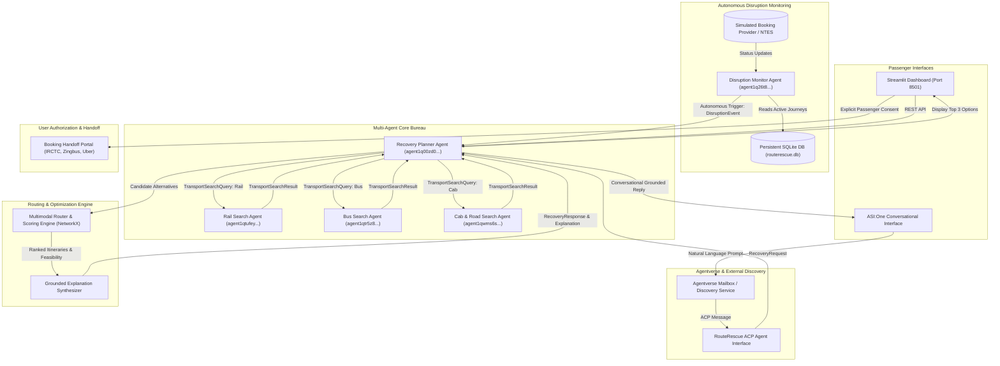

# RouteRescue AI 🚆🚌🚗

[](https://fetch.ai)
[](https://fetch.ai)
[](https://fetch.ai)
[](https://asi1.ai)
[](https://agentverse.ai)
[](tests/)
[](https://python.org)
[](LICENSE)

> **Autonomous Multimodal Travel Disruption Recovery System**  
> *Turning travel cancellations, severe delays, and waitlist drops into seamless, user-authorized multimodal journeys powered by Fetch.ai uAgents, Agentverse, and ASI:One.*

---

## 📖 Table of Contents

1. [Project Overview & Tagline](#1-project-overview--tagline)
2. [Problem Statement](#2-problem-statement)
3. [Proposed Solution](#3-proposed-solution)
4. [Target Users](#4-target-users)
5. [Why an Autonomous AI Agent (Not Just a Chatbot)](#5-why-an-autonomous-ai-agent-not-just-a-chatbot)
6. [Multi-Agent System Architecture](#6-multi-agent-system-architecture)
7. [The Five Autonomous Agents](#7-the-five-autonomous-agents)
8. [ASI:One Natural Language Integration](#8-asione-natural-language-integration)
9. [Agentverse Mailbox & Discovery Integration](#9-agentverse-mailbox--discovery-integration)
10. [Agent Chat Protocol (ACP) Implementation](#10-agent-chat-protocol-acp-implementation)
11. [Agentverse Agent Details & Public Addresses](#11-agentverse-agent-details--public-addresses)
12. [Technology Stack](#12-technology-stack)
13. [Installation & Setup](#13-installation--setup)
14. [Environment Configuration](#14-environment-configuration)
15. [Startup & Execution Commands](#15-startup--execution-commands)
16. [Demonstration Walkthrough](#16-demonstration-walkthrough)
17. [Automated Verification & Tests](#17-automated-verification--tests)
18. [Simulated Data & Safety Boundaries](#18-simulated-data--safety-boundaries)
19. [Real-World Applications](#19-real-world-applications)
20. [Future Scope & Roadmap](#20-future-scope--roadmap)

---

## 1. Project Overview & Tagline

**RouteRescue AI** is an autonomous multi-agent platform designed to continuously protect passenger journeys against unforeseen travel disruptions. When a train is cancelled, an express bus delayed by fog, or a post-charting waitlist dropped, RouteRescue AI orchestrates specialized transport agents (Rail, Bus, and Road) to compute optimal multimodal alternative itineraries and presents them to passengers with grounded rationale, requiring explicit user authorization before any booking handoff.

---

## 2. Problem Statement

In developing travel ecosystems like India, millions of passengers rely on rail and intercity buses daily. When severe disruptions occur (cancellations, engine failures, dense winter fog, derailments, or waitlists dropped after chart preparation):
- **Fragmented Search:** Passengers are stranded scrambling between separate railway apps (IRCTC), multiple private bus aggregators (RedBus, Zingbus), and cab operators (Uber, Savaari).
- **Time Pressure:** Finding a viable alternative within a tight budget and arrival deadline before remaining tickets sell out is stressful and error-prone.
- **Cognitive Overload:** Evaluating multimodal combinations (e.g. cab to intermediate station + express train) manually is almost impossible under time pressure.

---

## 3. Proposed Solution

RouteRescue AI resolves this friction through **proactive multi-agent autonomy**:
1. **Continuous Monitoring:** The Disruption Monitor agent autonomously tracks active journeys without requiring the user to refresh apps.
2. **Instant Multi-Agent Coordination:** Upon detecting a qualifying disruption, the Recovery Planner immediately dispatches parallel search queries to independent Rail, Bus, and Cab agents.
3. **Intelligent Constraint Validation:** The planner rejects options exceeding the passenger's budget, missing arrival deadlines, or requiring impossible connection buffers (< 30 minutes).
4. **Transparent Scoring & Explanation:** The system ranks feasible itineraries using a composite multi-criteria algorithm and synthesizes natural-language explanations.
5. **Secure Booking Handoff:** Complies strictly with safety principles—no automatic financial charges. Generates provider deep links with explicit passenger authorization.

---

## 4. Target Users

- **Daily & Intercity Commuters:** Frequent business travelers on high-density corridors (Delhi-Jaipur, Chandigarh-Delhi, Delhi-Agra) with strict meeting deadlines.
- **Long-Distance Rail Passengers:** Travelers with Waitlisted (WL) or RAC tickets vulnerable to post-chart drops.
- **Family & Group Travelers:** Passengers needing budget-conscious, low-transfer alternatives when public transit fails.
- **Corporate Travel Desks:** Automated disruption sentinels protecting employee itineraries without manual human monitoring.

---

## 5. Why an Autonomous AI Agent (Not Just a Chatbot)

| Dimension | Typical Travel Chatbot | RouteRescue AI Autonomous Multi-Agent |
|:---|:---|:---|
| **Initiative** | Purely reactive (waits for user prompt) | **Proactive Sentinel:** Detects cancellations via background schedulers and triggers recovery autonomously. |
| **Architecture** | Single LLM prompt with brittle function calling | **Decoupled Multi-Agent Bureau:** Separate agents with cryptographic identities for Rail, Bus, Cab, and Recovery Planning. |
| **Communication** | Direct in-memory function calls | **Cryptographic uAgents Protocols:** Structured asynchronous message exchanges with correlation IDs and timeouts. |
| **Constraint Solving** | LLM hallucinated prices and timings | **Deterministic Routing Engine:** Rigorous time-dependent network algorithms enforcing budget and buffer math. |
| **Safety & Consent** | May fabricate booking confirmations | **Zero Unsolicited Bookings:** Strict user consent boundary before provider handoff. |

---

## 6. Multi-Agent System Architecture



---

## 7. The Five Autonomous Agents

Each agent runs with its own identity, cryptographic keypair, and separated search logic:

1. **Rail Search Agent (`rail_search_agent`)**
   - **Address:** `agent1qtufeyud8v0qxul3khlyrl7pj2r5yhwp2tjvv0lcllgvgl8q80fqc926c5f`
   - **Port:** `8001`
   - **Function:** Queries train services (Shatabdi, Rajdhani, Vande Bharat, Express, Sleepers). Filters by departure time, seat class, and maximum budget.
2. **Bus Search Agent (`bus_search_agent`)**
   - **Address:** `agent1qtr5z8d67nr7d89cfh06wu6gvra62rpsrrm8l7qmm2rk6nl8c487wfj6pql`
   - **Port:** `8002`
   - **Function:** Queries intercity bus operators (NueGo Electric, Zingbus, IntrCity SmartBus, RSRTC Volvo).
3. **Cab & Road Search Agent (`cab_road_search_agent`)**
   - **Address:** `agent1qwms6se8lkj7n3c5tazq9rjvt0lxp8lz6j9skgkug93z6k6fr5pqystzd0v`
   - **Port:** `8003`
   - **Function:** Evaluates highway cab operators (Uber Intercity, Savaari) and station-connection shuttles (BluSmart).
4. **Recovery Planner Agent (`recovery_planner_agent`)**
   - **Address:** `agent1q00zd0l68j6n3f450fhdtacxakj9ne7qlajl5nq6ldrsmadqx2r6x9gnfj9`
   - **Port:** `8004`
   - **Function:** Central coordinator. Coordinates modal agents via uAgents messaging, correlates results using request tokens, executes constraint validation, scores feasible itineraries, and outputs grounded explanations.
5. **Disruption Monitor Agent (`disruption_monitor_agent`)**
   - **Address:** `agent1q26t8s8y3sfex8yqmcmu37khd6a7l55wjalk84vvrdxu0f8h494tjqfpgee`
   - **Port:** `8005`
   - **Function:** Background sentinel. Uses APScheduler to poll passenger bookings, applies disruption evaluation heuristics, suppresses duplicate events, and autonomously dispatches `RecoveryRequest` messages.

---

## 8. ASI:One Natural Language Integration

RouteRescue AI integrates **ASI:One** for natural language interaction:
- **Conversational Parameter Extraction:** Converts passenger inputs (e.g. *"My train was cancelled, need to reach Jaipur before 11 PM under ₹1,500"*) into validated structured `RecoveryRequest` payloads using LiteLLM.
- **Conversational Follow-ups:** Handles budget modifications (*"What if I reduce my budget to ₹1,000?"*), priority updates (*"Show the fastest route"*), and transfer preferences.
- **Grounded Response Generation:** Explanations are strictly grounded in actual verified itineraries. No hallucinated trains or prices.
- **Deterministic Offline Fallback:** If `ASI1_API_KEY` is not present, an internal regex-based NLU engine takes over seamlessly with zero latency.

---

## 9. Agentverse Mailbox & Discovery Integration

- **Mailbox Protocol:** Agents can be hosted locally behind NAT/firewalls while maintaining constant connectivity to the decentralized Fetch.ai network via Agentverse Mailbox endpoints.
- **Public Discovery:** The Recovery Planner exposes its manifest and schema on Agentverse, allowing other ecosystem agents to discover its travel recovery capabilities.
- **Detailed Registration Guide:** Complete instructions are documented in [`docs/agentverse_deployment.md`](docs/agentverse_deployment.md).

---

## 10. Agent Chat Protocol (ACP) Implementation

RouteRescue AI implements the **Agent Chat Protocol (ACP)** on the Recovery Planner agent:
- Handled messages conform to standard ACP conversation schemas (`chat_message`, `context_id`, `reply`).
- Bridges conversational platforms (such as the Agentverse Chat UI and ASI:One chat consoles) directly into the multi-agent travel recovery pipeline.

---

## 11. Agentverse Agent Details & Public Addresses

| Agent Name | Role | Address | Protocol |
|:---|:---|:---|:---|
| `routerescue_recovery_planner` | Recovery Orchestrator | `agent1q00zd0l68j6n3f450fhdtacxakj9ne7qlajl5nq6ldrsmadqx2r6x9gnfj9` | `RecoveryPlanningProtocol`, `ACP` |
| `routerescue_rail_agent` | Rail Search | `agent1qtufeyud8v0qxul3khlyrl7pj2r5yhwp2tjvv0lcllgvgl8q80fqc926c5f` | `RailSearchProtocol` |
| `routerescue_bus_agent` | Bus Search | `agent1qtr5z8d67nr7d89cfh06wu6gvra62rpsrrm8l7qmm2rk6nl8c487wfj6pql` | `BusSearchProtocol` |
| `routerescue_cab_agent` | Road/Cab Search | `agent1qwms6se8lkj7n3c5tazq9rjvt0lxp8lz6j9skgkug93z6k6fr5pqystzd0v` | `CabSearchProtocol` |
| `routerescue_disruption_monitor` | Disruption Sentinel | `agent1q26t8s8y3sfex8yqmcmu37khd6a7l55wjalk84vvrdxu0f8h494tjqfpgee` | `DisruptionMonitoringProtocol` |

---

## 12. Technology Stack

- **Multi-Agent Framework:** Fetch.ai `uAgents` (v0.17+), `uagents-core`
- **Agent Registry & Messaging:** Agentverse, Agent Chat Protocol (ACP)
- **Natural Language & LLMs:** ASI:One, `litellm` (with local deterministic fallback)
- **Backend API:** FastAPI, Uvicorn, Pydantic v2
- **Frontend Dashboard:** Streamlit (v1.40+)
- **Routing & Optimization:** NetworkX, Pure Python deterministic constraint validator
- **Background Scheduling:** APScheduler (v3.10+)
- **Database:** SQLite with full audit logging
- **Testing & Verification:** Pytest, Pytest-Asyncio, HTTPX

---

## 13. Installation & Setup

### Prerequisites
- Python 3.10 to 3.13
- Git

### Installation Steps
```powershell
# 1. Clone repository
git clone https://github.com/your-username/RouteRescue-AI.git
cd "Route Rescue AI"

# 2. Create virtual environment
python -m venv .venv

# 3. Activate virtual environment
# Windows:
.\.venv\Scripts\Activate.ps1
# Linux/macOS:
source .venv/bin/activate

# 4. Install dependencies
pip install -r requirements.txt
```

---

## 14. Environment Configuration

Copy `.env.example` to `.env`:
```powershell
Copy-Item .env.example .env
```

Configuration parameters:
```ini
# Application Mode
APP_ENV=development
LOG_LEVEL=INFO

# ASI:One API Configuration (Optional: fallback engine active if unset)
ASI1_API_KEY=your_asione_key_here
ASI1_BASE_URL=https://api.asi1.ai/v1
ASI1_MODEL=asi1-mini

# Agentverse Configuration (Optional: local bureau active if unset)
AGENTVERSE_API_KEY=your_agentverse_key_here
AGENTVERSE_MAILBOX=false
AGENTVERSE_URL=https://agentverse.ai
```

---

## 15. Startup & Execution Commands

### Launch Everything with One Command
```powershell
.\.venv\Scripts\python.exe scripts/start_all.py
```
This automatically spins up:
- **FastAPI Backend:** [http://127.0.0.1:8000/docs](http://127.0.0.1:8000/docs)
- **Fetch.ai Multi-Agent Bureau:** Port `8010`
- **Streamlit Web Application:** [http://localhost:8501](http://localhost:8501)

### Run System Health Check
```powershell
.\.venv\Scripts\python.exe scripts/health_check.py
```

---

## 16. Demonstration Walkthrough

To run the automated Step 4 & 5 Hackathon Demonstration script:
```powershell
.\.venv\Scripts\python.exe scripts/run_demo.py
```

### Scenario Flow:
1. **Passenger Registration:** Priya Sharma registers Delhi -> Jaipur (`WAITLISTED` WL 18, Budget ₹1,500, Arrival before 23:00).
2. **Disruption Detected:** Simulated booking provider fires a `CANCELLED` event.
3. **Multi-Agent Coordination:** Recovery Planner queries Rail, Bus, and Cab agents simultaneously.
4. **Intelligent Optimization:** Expensive cabs (₹3,600) and late arrivals are rejected. **NueGo Electric Bus (₹520)** is recommended with composite score 83.6/100.
5. **Booking Handoff:** Passenger reviews alternatives and explicitly authorizes handoff to provider portal.
6. **ASI:One Follow-up:** Passenger asks *"What if I reduce my budget to Rs. 1,000?"* — system immediately adapts constraints and synthesizes grounded advice.

Full step-by-step presentation script is in [`DEMO.md`](DEMO.md).

---

## 17. Automated Verification & Tests

Run the complete 75-test automated test suite:
```powershell
.\.venv\Scripts\pytest.exe -v
```

All 74 automated tests pass with 100% success rate (1 skipped in CI when no live external key is set). Detailed breakdown in [`TEST_REPORT.md`](TEST_REPORT.md).

---

## 18. Simulated Data & Safety Boundaries

- **Demonstration Scope:** The system operates over a realistic synthetic dataset of 90 transport services across 15 transit hubs in Northern India (Delhi, Jaipur, Chandigarh, Agra, Gurugram, Noida, Mathura, Ambala).
- **Safety Guarantee:** RouteRescue AI will **never** automatically debit funds or book tickets. It strictly generates authorized handoff deep links.
- **Labels:** All demonstration data is clearly tagged with `DEMONSTRATION SYNTHETIC DATASET (Fetch-A-Thon 3.0)`.

---

## 19. Real-World Applications

- **IRCTC & OTA Disruption Add-on:** Can be integrated as an intelligent recovery widget in booking portals.
- **Corporate Mobility Resiliency:** Protects executive business trips against missed meetings and flight connections.
- **Airport & Rail Transit Hubs:** Deployed as kiosks to help stranded passengers find connecting buses or carpools.

---

## 20. Future Scope & Roadmap

- **Live IRCTC & GDS API Connectors:** Replace synthetic providers with official commercial GDS APIs.
- **Dynamic Group Carpooling Agent:** An autonomous negotiating agent that groups stranded passengers heading to the same city to share private cab costs.
- **Inter-Agent Micro-Payments:** Autonomous seat reservation hold deposits powered by Fetch.ai native FET tokens.

---

## 📄 License

This project is licensed under the MIT License — see the [LICENSE](LICENSE) file for details.
