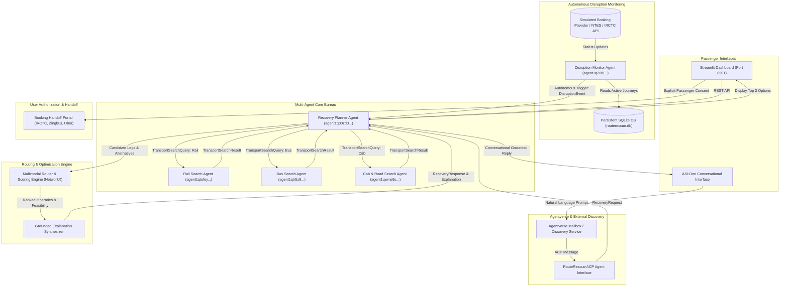
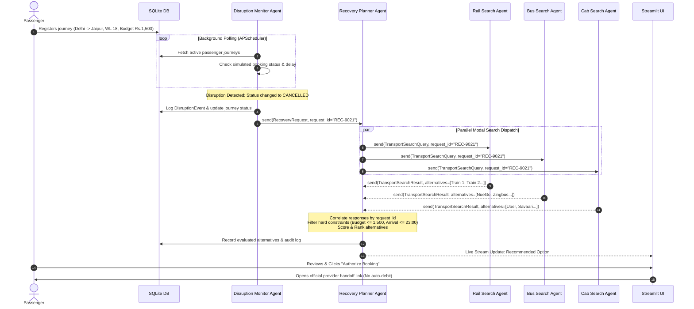
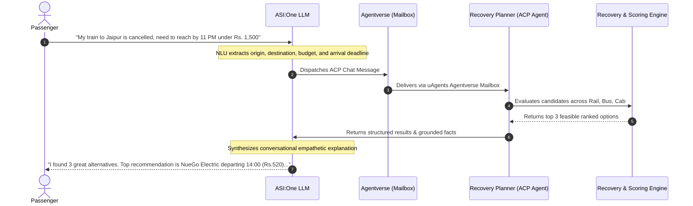

# RouteRescue AI — Multi-Agent System Architecture

## 1. High-Level Architecture Overview

RouteRescue AI is an autonomous, multimodal travel disruption recovery platform built on the **Fetch.ai uAgents** framework, **ASI:One**, **FastAPI**, and **Streamlit**.

The system features two asynchronous entry points:
1. **Reactive / Push Workflow:** The **Disruption Monitor Agent** periodically monitors active passenger journeys against a booking provider, detects cancellations or severe delays, and autonomously triggers the **Recovery Planner Agent**.
2. **Interactive / Conversational Workflow:** A passenger converses with **ASI:One**, which communicates via the **Agent Chat Protocol (ACP)** and **Agentverse** to instruct the **Recovery Planner Agent** to evaluate alternative itineraries.

---

## 2. Multi-Agent Bureau & Communication Flow

### 2.1 The Five Specialized Agents

Each agent in RouteRescue AI is an independent entity with its own distinct cryptographic identity, uAgents address, communication protocols, and decoupled search logic:

1. **Rail Search Agent (`rail_search_agent` | `agent1qtufeyud8v0qxul3khlyrl7pj2r5yhwp2tjvv0lcllgvgl8q80fqc926c5f`)**
   - **Port:** 8001
   - **Role:** Queries high-speed, express, and overnight rail schedules across Northern Indian transit corridors (e.g. Shatabdi, Rajdhani, Vande Bharat).
   - **Protocol:** `RailSearchProtocol` (`v1.0.0`) handling `TransportSearchQuery` and returning `TransportSearchResult`.

2. **Bus Search Agent (`bus_search_agent` | `agent1qtr5z8d67nr7d89cfh06wu6gvra62rpsrrm8l7qmm2rk6nl8c487wfj6pql`)**
   - **Port:** 8002
   - **Role:** Queries premium intercity electric, Volvo, and AC sleeper bus providers (Zingbus, IntrCity SmartBus, NueGo Electric, RSRTC).
   - **Protocol:** `BusSearchProtocol` (`v1.0.0`).

3. **Cab & Road Search Agent (`cab_road_search_agent` | `agent1qwms6se8lkj7n3c5tazq9rjvt0lxp8lz6j9skgkug93z6k6fr5pqystzd0v`)**
   - **Port:** 8003
   - **Role:** Queries on-demand intercity highway cabs and intra-city connection shuttles (Uber Intercity, Savaari, BluSmart).
   - **Protocol:** `CabSearchProtocol` (`v1.0.0`).

4. **Recovery Planner Agent (`recovery_planner_agent` | `agent1q00zd0l68j6n3f450fhdtacxakj9ne7qlajl5nq6ldrsmadqx2r6x9gnfj9`)**
   - **Port:** 8004
   - **Role:** Central orchestrator. Coordinates modal search agents, aggregates responses asynchronously using unique correlation `request_id` tokens, enforces hard constraints (budget, deadline, transfers), executes composite multi-criteria scoring, and synthesizes grounded explanations.
   - **Protocols:** `RecoveryPlanningProtocol` (`v1.0.0`), `AgentChatProtocol` (`v1.0.0`).

5. **Disruption Monitor Agent (`disruption_monitor_agent` | `agent1q26t8s8y3sfex8yqmcmu37khd6a7l55wjalk84vvrdxu0f8h494tjqfpgee`)**
   - **Port:** 8005
   - **Role:** Background sentinel. Uses APScheduler to poll passenger journeys, detects qualifying delays (>45 min), cancellations, or dropped waitlists, checks deduplication caches, and autonomously dispatches `RecoveryRequest` to the Planner.
   - **Protocols:** `DisruptionMonitoringProtocol` (`v1.0.0`).

---

## 3. Communication Sequence Diagrams

### 3.1 Autonomous Disruption Monitoring & Recovery Sequence

### 3.2 Conversational Flow via ASI:One and ACP

---

## 4. Multi-Criteria Scoring & Optimization Model

Each candidate journey $j$ is evaluated against a normalized composite score $S(j) \in [0, 100]$:

$$S(j) = 100 \times \left( w_{\text{cost}} \cdot S_{\text{cost}}(j) + w_{\text{dur}} \cdot S_{\text{dur}}(j) + w_{\text{rel}} \cdot S_{\text{rel}}(j) + w_{\text{dir}} \cdot S_{\text{dir}}(j) \right)$$

Where:
- $S_{\text{cost}}(j) = 1.0 - \frac{\text{Fare}(j)}{\text{Max Budget}}$ (Economic efficiency)
- $S_{\text{dur}}(j) = 1.0 - \frac{\text{Duration}(j) - \text{Min Duration}}{\text{Max Duration} - \text{Min Duration}}$ (Transit speed)
- $S_{\text{rel}}(j) = \text{Reliability Score}$ (Historical on-time punctuality)
- $S_{\text{dir}}(j) = \begin{cases} 1.0 & \text{if 0 transfers} \\ 0.7 & \text{if 1 transfer} \\ 0.4 & \text{if } \ge 2 \text{ transfers} \end{cases}$ (Directness preference)

### Hard Constraint Filters (Must-Pass Rules)
A journey is strictly eliminated if:
1. $\text{Total Fare} > \text{Max Budget}$
2. $\text{Estimated Arrival} > \text{Latest Acceptable Arrival}$
3. $\text{Departure Time} < \text{Earliest Departure}$
4. $\text{Transfers} > \text{Max Permitted Transfers}$
5. $\text{Connection Buffer} < 30 \text{ minutes}$ (for multimodal transfers)
6. $\text{Seat Status} == \text{SOLD\_OUT}$
